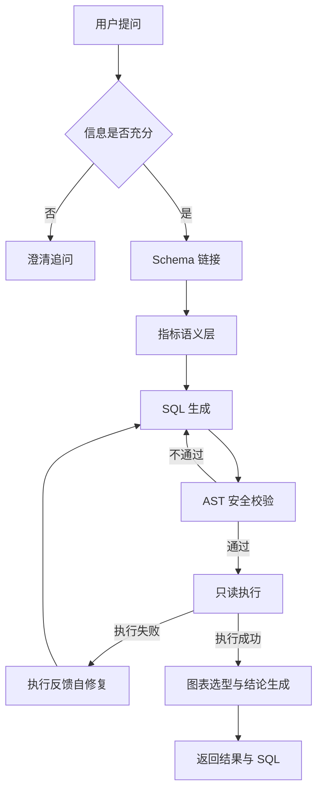

# 智能问数 Agent

基于大语言模型的中文 Text-to-SQL 数据问答系统。将自然语言业务问题转换为 SQL，经安全校验后在 DuckDB 上执行，并输出结果、图表与结论。

项目聚焦于 Text-to-SQL 在真实业务场景中的工程化问题：Schema 规模、指标口径、SQL 安全性、结果可评测性。

> 状态：SQL 生成、只读执行、评测体系与指标语义层已完成。调优集 26/26，正在扩充评测集并做留出集验证；API 与前端在路线图中。

## 目录

- [背景与目标](#背景与目标)
- [功能特性](#功能特性)
- [系统架构](#系统架构)
- [快速开始](#快速开始)
- [使用说明](#使用说明)
- [评测](#评测)
- [数据模型](#数据模型)
- [技术选型](#技术选型)
- [项目结构](#项目结构)
- [路线图](#路线图)
- [设计决策](#设计决策)
- [开发](#开发)

## 背景与目标

业务方获取数据的常规路径是提交需求、等待数据团队排期，反馈周期通常以天计。Text-to-SQL 的目标是缩短这一链路，使业务方可以直接用自然语言查询数据。

该任务的工程难点并不在于让语言模型生成语法正确的 SQL，而在于以下四个方面：

1. **Schema 规模**：表与列数量增长后无法整体放入上下文，需要检索与筛选；
2. **语义鸿沟**：业务指标（如 GMV、客单价）与物理列之间没有直接映射，需要显式的指标定义层；
3. **SQL 安全**：模型可能生成写操作、全表扫描或笛卡尔积，需要在执行前做静态校验；
4. **效果度量**：回答“看起来正确”不等于结果正确，需要可复现的评测体系。

本项目的目标是针对上述问题给出可验证的工程实现，并以执行准确率作为唯一的优化依据。

## 功能特性

| 能力 | 状态 | 说明 |
|---|---|---|
| 自然语言转 SQL | 已完成 | 支持 DuckDB 方言，输出结构化 JSON |
| 只读执行 | 已完成 | 只读连接、行数上限，杜绝写操作 |
| 结果集评测 | 已完成 | 26 道可执行题，结果集比对判分 |
| 模型选型对比 | 已完成 | 内置多模型速度/准确率对比脚本 |
| Schema 链接 | 开发中 | 按问题筛选相关表与列 |
| 指标语义层 | 开发中 | GMV、客单价等口径的显式定义 |
| AST 安全护栏 | 计划中 | 仅允许 SELECT、表白名单、强制 LIMIT |
| 执行反馈自修复 | 计划中 | 将数据库报错回灌模型，最多重试 2 轮 |
| 澄清与拒答 | 计划中 | 信息不足时反问而非猜测 |
| 图表与结论 | 计划中 | 依据结果形态选择图表并生成摘要 |
| Web 界面 | 计划中 | FastAPI + 前端 |

## 系统架构



当前已实现链路：`SQL 生成 → 只读执行 → 评测`。其余环节按路线图推进。

## 快速开始

### 环境要求

- Python 3.13
- [uv](https://github.com/astral-sh/uv)
- 可访问的 OpenAI 兼容模型服务（默认阿里云百炼）

### 安装与初始化

```bash
# 1. 安装依赖
uv sync

# 2. 配置环境变量
cp .env.example .env
# 编辑 .env，填入 LLM_API_KEY

# 3. 验证模型服务连通性
uv run python scripts/check_llm.py

# 4. 构建数据库（幂等，固定随机种子）
uv run python scripts/init_db.py

# 5. 启动评测
uv run python scripts/eval.py --self-check
uv run python scripts/run_baseline.py
```

## 使用说明

### 查询数据

```bash
uv run python scripts/query.py --tables                      # 查看表与行数
uv run python scripts/query.py --schema fact_order           # 查看表结构
uv run python scripts/query.py --sample dim_channel          # 抽样查看
uv run python scripts/query.py "SELECT COUNT(*) FROM fact_order"
uv run python scripts/query.py                               # 交互模式
```

### 运行评测

```bash
uv run python scripts/eval.py --selftest          # 校验比对器容错逻辑
uv run python scripts/eval.py --self-check        # 自检全部标准答案
uv run python scripts/run_baseline.py             # 全量评测
uv run python scripts/run_baseline.py --ids 21,22 # 指定题号
uv run python scripts/bench_models.py             # 模型选型对比
```

评测报告输出至 `results/baseline_report.json`。

## 评测

### 评测方法

评测采用**执行结果集比对**，而非 SQL 字符串相似度或模型裁判。判定规则如下：

- 行序无关，列序相关；
- 数值精度容差 0.01，金额统一按 `DECIMAL(12,2)` 量化；
- `NULL` 视为等价；
- 结果行数与列数必须一致。

该方法的优点是可复现、零额外成本，且能识别“语法合法但语义错误”的情况。

### 数据集

| 题型 | 题量 | 考察点 |
|---|---:|---|
| 单表聚合 | 8 | 过滤、聚合、极值 |
| 多表 JOIN | 6 | 外键关联、维度上卷 |
| 时间计算 | 6 | 环比、季度、跨天比较 |
| 口径陷阱 | 6 | GMV 是否含退款、客单价分母 |
| 澄清与拒答 | 5 | 信息不足时是否反问 |

计划扩充至 150 题。测试数据由固定种子生成，任意环境可复现。

### Baseline 结果

| 指标 | 数值 |
|---|---|
| 执行准确率 | 46.2%（12/26） |
| SQL 合法率 | 96.2%（25/26） |
| 平均延迟 | 2.7 s |
| P95 延迟 | 4.4 s |

分题型准确率：单表聚合 100%（8/8）、多表 JOIN 17%（1/6）、时间计算 33%（2/6）、口径陷阱 17%（1/6）。

错误分析表明，失败样本以**业务口径缺失**为主，而非 SQL 语法错误。典型错误包括将 GMV 定义为 `order_status = 'paid'`（漏计已发货、已完成与已退款订单），或未过滤取消订单。

### 引入指标语义层后

| 指标 | Baseline | + 语义层 |
|---|---|---|
| 执行准确率 | 46.2%（12/26） | 100%（26/26） |
| SQL 合法率 | 96.2% | 100% |
| 平均延迟 | 2.7 s | 3.4 s |
| 平均输入 token | 2,160 | 2,722 |

逐题对比：修复 14 道，回退 0 道。语义层以 YAML 定义 12 个指标、8 条全局口径规则、6 个维度映射，按问题检索后注入 prompt，注入文本约 1,000 字符（全量 schema 为 4,283 字符）。

> **关于 100% 的说明**：语义层是针对这 26 道题迭代调整出来的，100% 属于调优集（in-sample）表现，不代表泛化能力。项目正在将评测集扩充至 150 题，并保留不参与调优的题目作为留出集，用于报告可信的提升幅度。

## 数据模型

星型模型，共 12 张表，约 16 万行。

**维度表**

| 表 | 行数 | 说明 |
|---|---:|---|
| `dim_date` | 730 | 日期维表，含节假日与周末标记 |
| `dim_region` | 35 | 区域，大区 / 省 / 市三级 |
| `dim_customer` | 3,000 | 客户，含会员等级与注册渠道 |
| `dim_category` | 24 | 商品品类，一级 / 二级 |
| `dim_product` | 500 | 商品，含价格、成本与上下架状态 |
| `dim_channel` | 5 | 销售渠道 |
| `dim_campaign` | 14 | 营销活动 |

**事实表**

| 表 | 行数 | 说明 |
|---|---:|---|
| `fact_order` | 30,000 | 订单主表 |
| `fact_order_item` | 52,600 | 订单明细 |
| `fact_payment` | 27,925 | 支付流水 |
| `fact_refund` | 3,045 | 退款记录，含部分退款 |
| `fact_inventory_snapshot` | 45,000 | 商品库存日快照 |

数据在生成时刻意引入了若干业务特征，用于检验模型对口径的理解能力：跨天支付订单（1,707 笔）、历史订单中包含已下架商品（49 个）、收货城市与客户注册城市不一致（15%）、活动字段为空（约 70%）。完整字段说明见 [`docs/schema.md`](docs/schema.md)。

## 技术选型

| 组件 | 选型 | 理由 |
|---|---|---|
| 运行时 | Python 3.13 + uv | 依赖锁定，环境可复现 |
| 分析存储 | DuckDB 1.5 | 嵌入式列式数据库，单文件、零运维，适合 OLAP 场景 |
| 模型服务 | qwen3.8-max | 中文语义理解与 SQL 生成均衡；关闭思考链后延迟约 3 s |
| SQL 解析 | sqlglot | AST 级校验，支持多方言，便于后续替换执行引擎 |
| Web 框架 | FastAPI | 异步、类型友好，计划用于接口层 |

数据库层通过执行器封装，替换为 MySQL 或 ClickHouse 时仅需适配方言与连接层，不影响上层逻辑。

## 项目结构

```
app/
  api/         HTTP 接口（计划中）
  core/        config.py 配置管理、llm.py 模型客户端
  db/          executor.py 只读执行器
  schemas/     Pydantic 数据模型（计划中）
  services/    nl2sql.py SQL 生成服务
data/
  analytics.duckdb      业务数据库（不纳入版本控制）
  schema_meta.json      表、列、外键元数据
  eval/questions.jsonl  评测集
docs/
  schema.md             数据字典（自动生成）
scripts/
  init_db.py        建库、造数与元数据导出
  query.py          命令行查询工具
  eval.py           评测脚本（自检 + 结果集比对）
  run_baseline.py   baseline 评测
  bench_models.py   模型选型对比
  check_llm.py      模型服务连通性检查
results/              评测报告（不纳入版本控制）
tests/                单元测试（计划中）
web/                  前端（计划中）
```

## 路线图

- [x] 业务库建模与数据生成（12 张表）
- [x] 评测集与结果集比对评测脚本
- [x] Baseline NL2SQL（执行准确率 46.2%）
- [x] 模型选型对比与定版
- [x] 指标语义层（调优集 46.2% → 100%，待留出集验证）
- [ ] 评测集扩充至 150 题 + 留出集验证
- [ ] Schema 链接
- [ ] AST 安全护栏（只读、白名单、强制 LIMIT、超时中断）
- [ ] 执行反馈自修复
- [ ] 澄清与拒答能力
- [ ] 图表选型与结论生成
- [ ] FastAPI 接口与前端
- [ ] 部署与演示

## 设计决策

| 决策 | 说明 |
|---|---|
| 评测先行 | 先建立评测集与判分规则，再引入模型，确保优化可归因 |
| 结果集比对 | 以执行结果判分，避免 SQL 形态相似但结果错误被误判为正确 |
| 模型定版 | 固定模型与参数，保证不同阶段指标可比 |
| 关闭思考链 | 实测准确率持平，延迟降低约一个数量级，优先保障交互体验 |
| 单一事实来源 | 一份表定义同时生成 DDL、元数据与数据字典，避免文档与库不一致 |
| 执行器抽象 | 数据库访问收敛在单一执行器，便于替换存储引擎 |

## 开发

```bash
uv sync                     # 安装依赖
uv run python scripts/init_db.py    # 重建数据库
uv run python scripts/eval.py --self-check
```

代码规范：类型注解 + `from __future__ import annotations`；模块职责单一；所有评测与查询脚本均以项目根目录为工作目录运行。

## License

暂未指定。